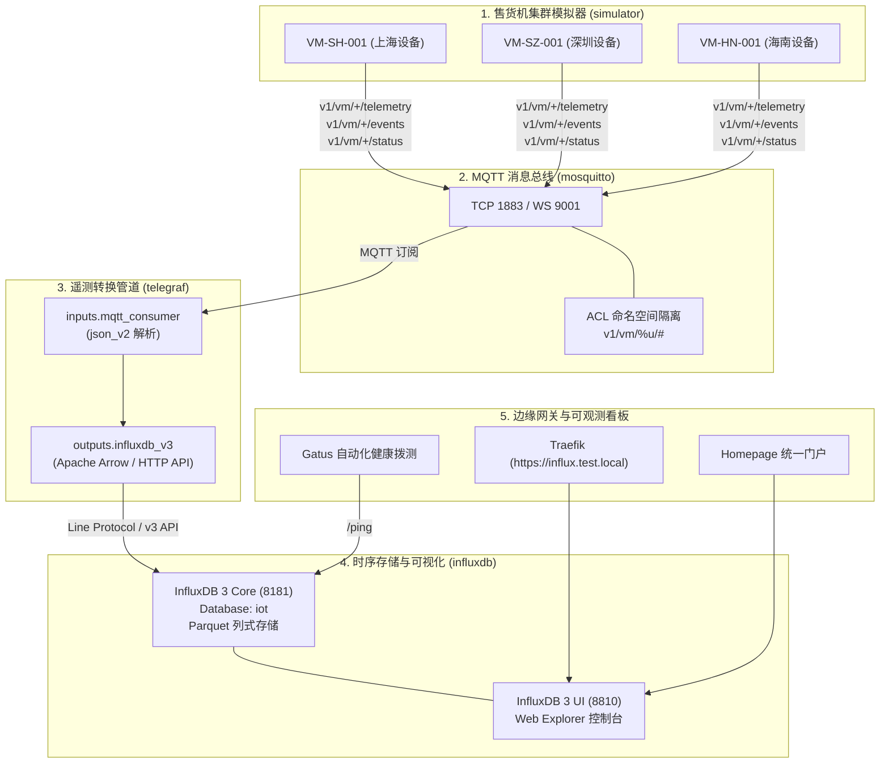

# IoT 冷链售货机物联网全栈流水线运维与使用手册 (IoT Pipeline Guide)

本手册详细记录了智能售货机 IoT 模拟集群（`simulator`）、消息 Broker（`mosquitto`）、遥测数据转换管道（`telegraf`）以及时序大数据引擎（`influxdb` 3 Core）的完整数据流、组件架构、启动运维与调试排障指南。

---

## 1. 架构与数据流拓扑 (Architecture & Data Flow)



---

## 2. 主题规划与数据契约规范 (Topic & Data Schema)

| 主题格式 | 生产者 | 消费者 | QoS | 说明与数据结构 |
| :--- | :--- | :--- | :--- | :--- |
| `v1/vm/{device_no}/telemetry` | Simulator | Telegraf | 0 | 设备周期上报遥测：电压、电流、4温区冷柜温度、气温、震动 g 值、4G 信号 RSSI、GPS 坐标 |
| `v1/vm/{device_no}/events` | Simulator | Telegraf | 1 | 异常与业务事件：`TEMP_OVERHEAT`（超温）、`VANDALISM_ALERT`（破坏）、`DOOR_OPENED`（开门） |
| `v1/vm/{device_no}/status` | Simulator | Telegraf | 1 (Retain) | 设备上下线与 LWT 遗嘱消息（`online` / `offline`），附带固件和硬件版本 |
| `v1/vm/{device_no}/commands` | 云端后台 | Simulator | 2 | 下发控制：出货（`DISPENSE`）、启停视频（`START_VIDEO`/`STOP_VIDEO`）、重启（`REBOOT`） |
| `v1/vm/{device_no}/commands/ack` | Simulator | Telegraf / 后台 | 1 | 设备指令确认响应应答（执行时长 `duration_ms`，错误码 `error_code`） |

---

## 3. InfluxDB 3 数据表设计 (Schema-on-Write)

Telegraf 自动将 MQTT JSON 数据清洗并按 measurement 写入 InfluxDB 3 中的 `iot` 数据库：

1. **`vm_telemetry`** (时序遥测表)
   - **Tags (索引维度)**: `device_no`
   - **Fields (量测指标)**: `voltage` (float), `current` (float), `uptime` (int), `door_closed` (bool), `temp_zone_0` ~ `temp_zone_3` (float), `ambient_temp` (float), `vibration_g` (float), `rssi` (int), `lat` (float), `lng` (float)
   - **Time**: 设备生成 ISO 时间戳精确对齐。

2. **`vm_events`** (告警与业务事件表)
   - **Tags**: `device_no`, `event_type`
   - **Fields**: `order_id` (str), `channel_id` (str), `error_code` (str), `g_force` (float)

3. **`vm_status`** (设备在线状态表)
   - **Tags**: `device_no`, `status`
   - **Fields**: `firmware` (str), `hardware` (str)

4. **`vm_command_acks`** (指令执行结果表)
   - **Tags**: `device_no`, `status`
   - **Fields**: `cmd_id` (str), `execution_duration_ms` (int), `error_code` (str)

---

## 4. 快速上手与操作指南 (Quick Start)

### 4.1 环境变量准备

在根目录 `.env` 中确认包含如下配置（默认已配置推荐值）：

```dotenv
# MQTT 凭据
MQTT_USERNAME=admin
MQTT_PASSWORD=admin123!

# InfluxDB 3 凭据与端口
INFLUXDB_PORT=8181
INFLUXDB_UI_PORT=8810
INFLUXDB_DATABASE=iot
INFLUXDB_TOKEN=apiv3_zXwIQ_nNIx-XsUN858t6lBQGkZ2tZljUdZA0TzpLp_0GJh6r6BaxnCddiaXb1wB7ocE9uOZYdlMbzDdgl0w00w
```

### 4.2 统一运维命令 (Justfile Commands)

| 运维命令 | 作用说明 |
| :--- | :--- |
| `just iot-up` | **一键启动** IoT 全栈服务（Mosquitto + InfluxDB + Telegraf + Simulator），并自动校验与创建 `iot` 数据库 |
| `just init-iot` | **单独初始化** InfluxDB 3 数据库，创建 `iot` 库并验证 API 连通性 |
| `just iot-status` | **查看状态**：输出当前 IoT 容器组运行与健康状态 |
| `just iot-sim-logs` | **跟踪日志**：实时输出售货机模拟器上报日志（平均温度、RSSI、门状态等） |
| `just iot-telegraf-logs` | **跟踪采集**：实时查看 Telegraf 消费与批处理入库状态 |
| `just iot-test` | **链路验证**：测试 MQTT Broker 连通性并向 InfluxDB 3 发起 SQL 表结构查询 |
| `just iot-down` | **停止服务**：安全停止 IoT 容器组件 |

---

## 5. 控制台与 Web 可视化 (Web Portals)

1. **InfluxDB 3 Explorer (数据可视化)**
   - **本地直连**: `http://localhost:8810`
   - **Traefik 域名**: `https://influx.test.local` (或 `https://influxdb.test.local`)
   - **初次连接配置**:
     - Server URL: `http://influxdb:8181` (容器间直连) 或 `http://localhost:8181` (本地直连)
     - API Token: 填写 `.env` 中的 `INFLUXDB_TOKEN`
     - Database: `iot`
   - 可在 UI 中使用标准 SQL 执行查询：

     ```sql
     SELECT time, device_no, temp_zone_0, voltage, current 
     FROM vm_telemetry 
     ORDER BY time DESC 
     LIMIT 20;
     ```

2. **Homepage 运维导航面板**:
   - 访问 `https://home.test.local`，在“存储与数据库”中可见 **InfluxDB 3**，在“通信与工作流”中可见 **Mosquitto** 与 **Telegraf**。

3. **Gatus 服务健康监控**:
   - 访问 `https://status.test.local`，可实时查看 InfluxDB 3、Mosquitto 等端点的可用性统计。

---

## 6. 排障与自检指南 (Troubleshooting)

1. **模拟器无法连接 Mosquitto (`ECONNREFUSED` / `ENOTFOUND`)**
   - 检查 `docker compose ps mosquitto` 是否处于健康状态。
   - 确认容器内部网络互联使用了服务名 `MQTT_HOST=mosquitto`，而非 `localhost`。

2. **Telegraf 写入 InfluxDB 失败 (`401 Unauthorized` 或 `404 Database not found`)**
   - 检查 `INFLUXDB_TOKEN` 是否一致配置在 `.env`，Telegraf 与 InfluxDB 容器环境变量需共享同一 Token。
   - 执行 `just init-iot` 确认 `iot` 数据库已成功创建。

3. **数据没有写入 InfluxDB**
   - 执行 `just iot-sim-logs` 确认模拟器正持续输出 `[TELEMETRY] Sent`。
   - 执行 `just iot-telegraf-logs` 查看是否有 JSON 字段解析警告。
   - 执行 `just iot-test` 检查 `SHOW TABLES` 是否能够查到 `vm_telemetry`。
